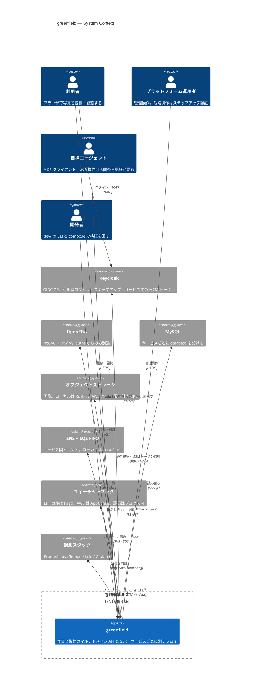
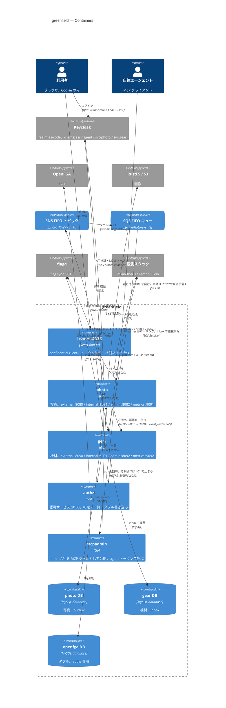
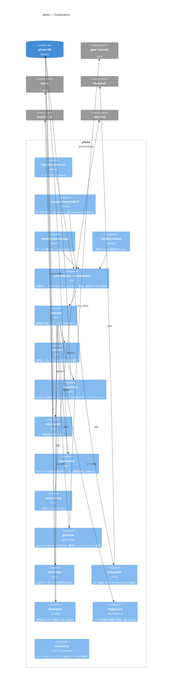
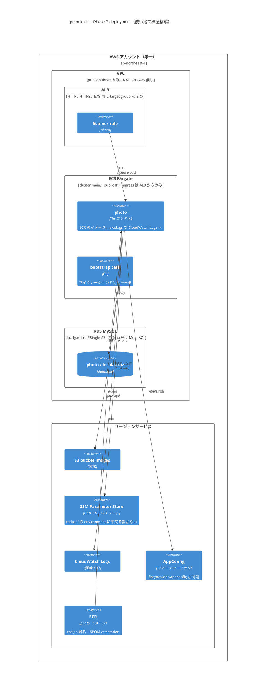

# 全体構成（C4 モデル）

greenfield の構成を C4 モデルの 4 段階で示す。上から順に粒度が細かくなる。
図は Mermaid の C4 記法で、GitHub 上でそのまま描画される。各図の下に、図では
伝わらない判断と制約を書く。正本は `02-architecture.md`・`03-platform.md`・
`conventions/` で、この文書は入口である。

| 段階 | 問い | 対象 |
|---|---|---|
| Context | 誰が、どのシステムと話すか | greenfield と外部システム |
| Container | 何がプロセスとして動くか | SSR・photo・gear・authz・DB・バス |
| Component | プロセスの中はどう分かれているか | photo の内部 |
| Deployment | どこで動くか | Phase 7 の AWS 検証構成（使い捨て） |

## Context — 誰が、どのシステムと話すか

図から読み取れないこと。

- 外部システムはすべて差し替え可能な前提で、つなぎ先は環境変数（URL / ARN / DSN）だけで決まる。コードの中に「同じアカウントにいる」前提は無い。本番系はアカウントを分けて TGW でつなぐ想定で、greenfield は 3 リスナーとポート分離で構造だけを模擬している（01-scope）
- 認証と認可は別のシステムである。Keycloak は「誰か」を決め、OpenFGA は「何をしてよいか」を決める。アプリは OpenFGA を直接呼ばず、authz サービスを経由する（03-platform）
- 自律エージェントは利用者と同じ入口を使うが、持てるトークンが AAL1 までに制限されている。危険操作は構造的に人間の再認証を要求する（check #14）

## Container — 何がプロセスとして動くか

図から読み取れないこと。

- 各サービスは external / internal / admin の 3 リスナーを別ポートで持つ。本番では ALB の 3 責務（TLS 終端・ホスト名振り分け・到達制御）に対応し、アプリは Listen するポートしか知らない（internal-07）
- サービス間の同期呼び出しは internal リスナーだけで、Keycloak の client_credentials による M2M トークンを `core/httpclient` が付ける。IAM ロールではつないでいないので、アカウントをまたいでも同じ仕組みで動く
- 非同期の経路は outbox → relay → SNS → SQS → inbox で、at-least-once。重複は受信側の inbox が弾き、relay が止まっても未送信レコードは DB に残る（check #8）。配送基盤の実装は `eventbus/snssqs` にあり、core は差し込み口しか持たない（ADR 0022）
- 画像の本体はアプリを通らない。photo が署名付き URL を発行し、ブラウザがストレージへ直接置く（ADR 0009）
- フラグは定義を同期してプロセス内で評価する。評価のたびに外部を呼ばないので、flagd が落ちても最後の定義で動く（ADR 0013）
- 観測は 3 本とも計装済みで、ログの trace_id とトレースの trace_id は同じ値（internal-06 §10.1）。compose の `obs` プロファイルで Grafana から相互に辿れる

## Component — photo の内部

図から読み取れないこと。

- v1 と v2 は同じ usecase につながる別のアダプタで、バージョンを持つのは handler だけ。旧版の廃止はアダプタ 1 つとスペック 1 ファイルの削除で済む（ADR 0017）
- 差し込み口（blobstore / flagsource）と replicaview の使い方は depguard が import 単位で強制する。規約ではなく lint が止める
- `core/*` は横断的関心事だけを持ち、OTel SDK や Prometheus クライアントは `telemetry` モジュールに置く。core を使う全サービスに依存を抱えさせない（internal-06）
- 書き込みは Atomic（1 トランザクション）で、同じトランザクションの中で outbox に追記する。イベントの送信はトランザクションの外で relay が行う（ADR 0012）

## Deployment — Phase 7 の AWS 検証構成

図から読み取れないこと。

- この構成は使い捨てである。`terraform apply` → 検証 → 当日 `destroy` で回し、立てっぱなしにしない。state はローカルで、remote state を持たない。Phase 7 の全検証（7.1〜7.5）で費用は $2.5 未満
- AWS に載せたのは photo だけで、gear と authz は載せていない。Keycloak / OpenFGA / SNS+SQS も AWS 上には無い（SNS/SQS の実機再演は 7.3 で別途）。サービスごとにアカウントを分けるには、Terraform のサービス単位への分割、ネットワーク接続（本番は TGW）、SNS/SQS のアカウント越えポリシー、デプロイの送り先ごとのロールが要る。コード側はつなぎ先が全部環境変数なので変更は要らない
- 観測はログだけ CloudWatch Logs へ送る。トレースは OTLP の送り先が未設定なので無効（no-op）で、アプリのメトリクスは集めていない。ALB の 5xx アラームだけがある
- NAT Gateway を置かず public subnet にタスクを置くのは費用のため。到達制御は security group で行う

## 読み方

- 新しいサービスを足すときは Container 図に 1 つ足し、external / internal / admin の 3 リスナーと DB、authz・Keycloak への線を同じ形で引く。`mise run scaffold <name>` が骨格を作る
- サービスを切り出したり除却したりするときの手順と実測は `verification-log/2026-09-30-boundary-redraw-drill.md`
- 図と実体がずれていないかは、この文書では検査していない。構成を変えた PR でこの文書を更新する
